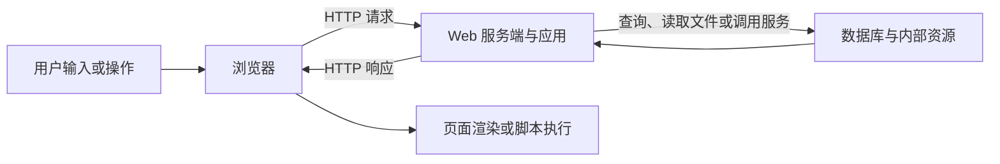

> 这篇回顾不是 Web 安全百科，而是一张起点地图。第一课只深入一个 SQL 注入样板，其他题型先知道“它解决什么问题”和“遇到时先观察什么”。
>
> 资料总入口：[WJimi 书签导航](https://wjimi.github.io/booknav/)

## 从网络安全全景到 Web 安全入门

今天我们先认识网络安全这个方向，再从一次 Web 请求出发，走通一个 SQL 注入样板，最后留下一条可以继续练习的路线。

> 网络安全不是“学会当黑客”，而是理解攻击、建设防护、守住法律与授权边界的长期工作。

---

## 今天只解决三个问题

1. 网络安全到底在做什么？
2. 一次 Web 请求为什么会产生安全问题？
3. 新手怎样练习，才算真的学会？

时间有限，我们不会把全部 Web 题型讲完。SQL 注入会作为完整样板，其他方向只建立地图。

| 时间 | 内容 | 目标 |
|---|---|---|
| 0–5 分钟 | 网络安全全景 | 先知道这个方向不只是攻击 |
| 5–14 分钟 | 请求、数据流与权限 | 学会观察一次请求 |
| 14–18 分钟 | Web 题型地图 | 知道以后会遇到什么 |
| 18–30 分钟 | SQL 注入样板 | 走通一次完整分析 |
| 30–34 分钟 | XSS 与 AI 时代练习 | 看现象，理解新反馈 |
| 34–37 分钟 | 授权边界 | 知道什么不能做 |
| 37–40 分钟 | 作业与总结 | 知道下一步怎么练 |

---

## 一、网络安全不等于黑客电影

影视作品常把网络安全等同于“突破系统”，但真实工作包含更多内容：

- 发现系统存在的风险。
- 修复缺陷并减少攻击面。
- 建设检测、响应和安全开发能力。
- 做审计、合规、风险管理和安全运营。
- 确保所有测试都在明确授权范围内。

### 网络安全要学什么

| 能力层 | 主要内容 |
|---|---|
| 计算机基础 | 操作系统、计算机网络、数据库、编程 |
| 安全核心 | Web 安全、密码学、攻防、漏洞分析 |
| 系统底层 | 汇编、逆向、内核等，部分方向要求较深 |
| 法律与管理 | 网络安全法、安全标准、审计与合规 |

### 三个主要方向

| 方向 | 主要工作 |
|---|---|
| 攻防安全 | 渗透测试、漏洞分析、红蓝对抗、安全研究 |
| 安全开发 | 安全工具、平台、检测能力和系统加固 |
| 安全治理 | 等保、风险评估、安全审计与合规管理 |

三个方向不是互斥的。攻防需要理解开发，开发需要理解攻击，治理也需要判断真实风险。

### 需要用现实眼光看待这个方向

网络安全有持续增长的需求，也存在明确的学习门槛：

- 需要网络、系统、编程和数据库等基础。
- 技术持续变化，不能靠一套工具长期工作。
- 岗位数量、地点和行业需求存在差异。
- 实战能力、复盘质量和解决问题能力非常重要。
- 薪资和前景与城市、学历、经验、行业及岗位有关，不适合用一句“高薪”概括。

如果你对原理有好奇心，愿意持续动手、查文档、做验证，并遵守法律与授权边界，这个方向值得尝试。只因为“黑客很酷”而没有任何实践，很容易在遇到门槛后失去兴趣。

---

## 二、一次 Web 请求发生了什么

```text
用户操作
→ 浏览器发出 HTTP 请求
→ 服务端解析请求
→ 查询数据库、读取文件或调用内部服务
→ 服务端生成响应
→ 浏览器渲染页面或执行脚本
```

URL 参数、表单、JSON、Cookie、请求头和上传文件都属于外部输入。

外部输入不一定恶意，但服务端不能只凭客户端的一面之词，就完全相信输入内容、用户身份和操作权限。

Web 系统不是“一个网页”，而是一条请求—响应链路：



用户输入可能来自 URL 参数、表单、JSON、Cookie、请求头和上传文件。这些内容都应当被视为外部输入。

### 安全分析先看数据流

```text
外部输入 → 处理或保存 → 危险操作 → 安全影响
```

常见危险操作包括：

- SQL 查询。
- 系统命令。
- 文件路径或文件包含。
- HTML 与脚本上下文。
- 服务端模板。
- 服务器发起的外部请求。
- 对象与功能权限判断。

我们不急着背 payload，先回答两个问题：

**输入从哪里来？最终去了哪里？**

---

## 三、登录了，不等于有权限

- 身份认证回答：你是不是你声称的人？
- 访问控制回答：你能不能执行当前操作或访问当前对象？

例如，用户 A 已经登录，不代表有权查看用户 B 的订单。如果服务端只检查“会话有效”，却不检查“这个对象属于谁”，就可能出现越权。

服务端每次都要重新判断：

1. 当前用户是谁？
2. 正在操作哪个对象？
3. 用户和对象是什么关系？
4. 当前操作需要什么权限？
5. 这些检查是否由服务端完成？

只在页面隐藏按钮并不安全，因为请求仍然可以被直接构造。

---

## 四、Web 安全题型地图

| 方向 | 一句话理解 |
|---|---|
| SQL 注入 | 输入改变了数据库查询的语义 |
| XSS | 输入被浏览器当成 HTML 或脚本执行 |
| 命令注入 | 输入影响了服务端执行的系统命令 |
| 文件上传与包含 | 输入影响了文件的存储、读取或执行 |
| SSRF | 服务器被诱导访问用户指定的目标 |
| SSTI | 输入被模板引擎当成模板代码 |
| 反序列化 | 不可信数据被还原成对象并触发危险逻辑 |
| 身份与访问控制 | 身份或权限判断能被绕过 |

今天不需要会打这些题。先知道每个方向“危险发生在哪里”，后续再按专题练习。

---

## 五、SQL 注入完整样板

下面的内容只用于本地或明确授权的靶场。

一个不安全的程序可能这样构造查询：

```php
$id = $_GET['id'];
$sql = "SELECT id, username FROM users WHERE id = '$id'";
```

正常输入 `1` 时，查询想表达：

```sql
SELECT id, username FROM users WHERE id = '1';
```

在指定靶场里，输入：

```text
1' OR '1'='1' -- 
```

可能让查询变成：

```sql
SELECT id, username FROM users WHERE id = '1' OR '1'='1' -- ';
```

这里发生了三件事：

1. 单引号改变了 SQL 字符串的边界。
2. `OR` 改变了原本的条件判断。
3. 注释符处理掉后面的语句，具体写法依赖数据库。

### 现场复现顺序

1. 输入正常值，记录页面基线。
2. 增加一个单引号，观察错误或响应变化。
3. 结合源码提出假设：输入是否进入了 SQL？
4. 一次只改一个条件，观察查询语义是否变化。
5. 用源码确认根因，不只凭页面现象下结论。
6. 修复后再发送原请求，确认问题不再成立。

### 根因与修复

根因不是“用户输入了单引号”，而是程序把用户数据当成了 SQL 语法。

修复重点是参数化查询或预编译语句，让数据库把输入当作数据；输入校验和数据库最小权限是补充防线。

> 这一条 payload 只适用于指定靶场，不是所有 SQL 注入环境都能使用。

---

## 六、XSS 先看一个现象

在故意准备的靶场中，可能用下面的输入观察页面行为：

```html
<script>alert('XSS')</script>
```

如果弹窗，说明该页面上下文把输入当成了代码，而不是纯文本。

我们先记住一句话：

**XSS 是用户数据进入了页面上下文，而浏览器把数据当成了 HTML 或脚本。**

修复重点是按上下文输出编码，并优先使用安全 DOM 接口。具体绕过和不同上下文，后续专题再展开。

---

## 七、AI Agent 时代怎样学 CTF

AI Agent 让答案更容易获得，单纯“拿到 flag”带来的反馈会变弱。

但这不代表 CTF 没有价值。它仍然是有授权、可复现、低成本的训练场。变化的是评价标准：

- 能否说明输入点和第一假设？
- 能否验证 AI 给出的建议？
- 能否解释根因、完成修复和复测？
- 换一个条件，能否重新分析？
- 能否把方法迁移到项目或代码审计？

建议按下面的顺序使用 AI：

1. 先自己观察 10 到 15 分钟。
2. 第一轮只问提示、可能的数据流和下一步实验。
3. 对每条建议都在授权靶场中验证。
4. 最后记录 AI 建议了什么，你验证或否决了什么。

AI 可以加快查资料和生成实验，但不能授予测试权限，也不能替你承担责任。

---

## 八、练习边界与课后任务

### 可以做的

- 测试自己搭建的本地靶场。
- 使用学校明确授权的靶场。
- 参加规则和范围明确的公开 CTF。

### 不可以做的

- 因为网站可以公开访问，就直接扫描或测试。
- 对陌生公网目标尝试注入、上传或命令执行。
- 让 AI Agent 绕过授权、平台规则或赛事范围。

### 课后必做

1. 本地启动 SQLi-Labs 或课堂指定靶场。
2. 复现有回显和无回显的 SQL 注入观察。
3. 保存正常请求和异常请求截图。
4. 每题写三行：输入点、我做了什么、根因与影响。
5. 使用了 AI 时，补充一行：验证或否决了什么。
6. 提交一个真实卡点：预期、实际、已经排除了什么。

第一课验收只看四件事：

- 是否在授权环境完成。
- 能否稳定复现。
- 能否用证据解释根因。
- 是否知道下一步补什么。

---

## 九、课后从哪里继续

统一资料入口：[WJimi 书签导航](https://wjimi.github.io/booknav/)

最常用的三个栏目：

- **靶场与练习**：找题和练习环境。
- **安全工具**：找观察请求和处理数据的工具。
- **题解与博客**：卡住后对照思路，不直接照抄答案。

第一课建议从这三个资源开始：

1. [Hello-CTF 敏感信息泄露](https://hello-ctf.com/hc-web/sensitive_info/#ds_store)
2. [SQLi-Labs](https://github.com/Audi-1/sqli-labs)
3. [PortSwigger Web Security Academy](https://portswigger.net/web-security)

---

## 今天请记住

- 网络安全不只是攻击，还包括防护、开发、治理和法律边界。
- Web 安全问题先看数据流：输入从哪里来，最终进入哪里。
- 认证解决“你是谁”，授权解决“你能不能做”。
- SQL 注入的根因是把数据当成了 SQL 语法。
- AI 能加快答案生成，但验证、解释和授权责任仍然属于人。

第一课不需要全会。先把一次请求看清，把一个样板跑通，把每一步留下证据。
